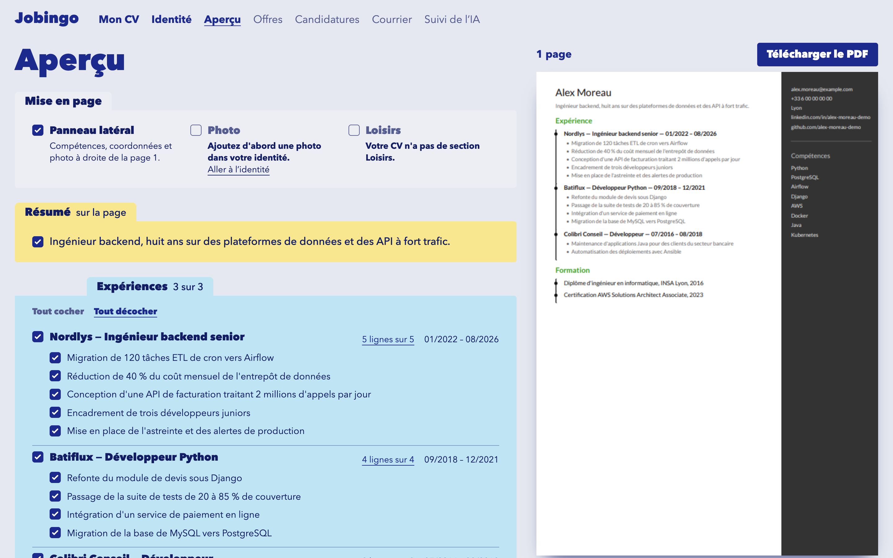
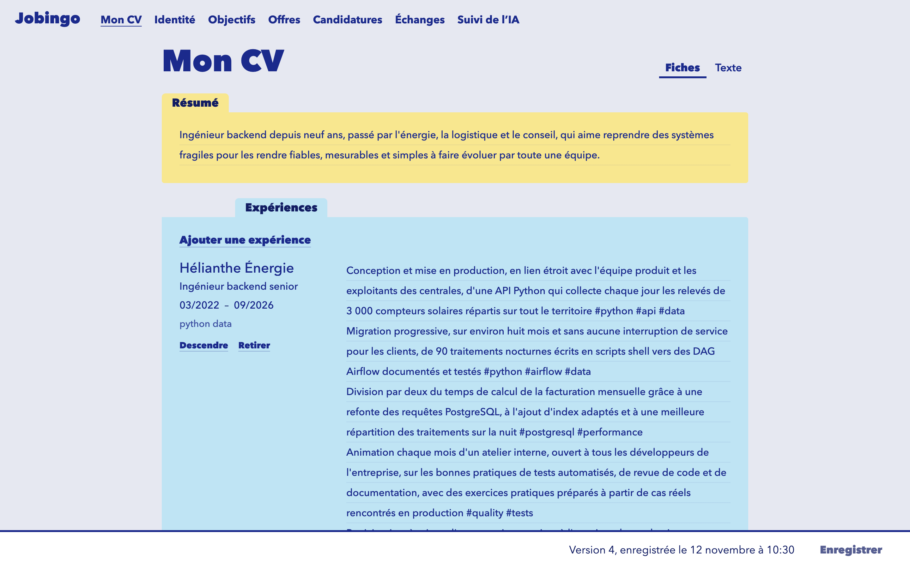
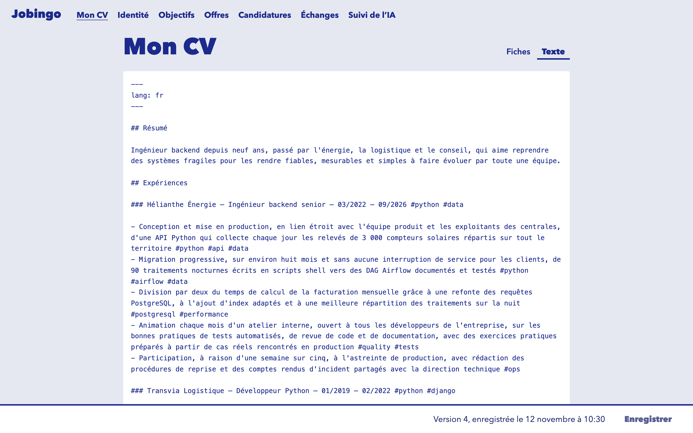

# Jobingo

An AI job search assistant that keeps the AI on a short leash. It collects and ranks job offers, tracks applications, tailors a CV and a cover letter to each offer, and drafts replies to recruiters. Nothing leaves without a human click.

**Status: work in progress.** The foundation, the CV editor and the CV page work today. The AI features do not exist in this repository yet: see [what works today](#what-works-today) and the [roadmap](#roadmap). The interface is in French.



## Where it comes from

Jobingo succeeds a private Python proof of concept: a local, single-user app that already delegated bounded tasks to Claude behind an approval queue, with its prompts measured by evals.

The POC proved that the idea works. Jobingo rebuilds it as a real client-server application, with a typed API, PostgreSQL and a designed interface. Code is ported file by file, and reviewed at each port. Prompts and eval suites come over, but scores do not: every score gets measured again here before it is published.

## What this project sets out to demonstrate

It is a public portfolio project. It aims to show how to deliver an AI product that works, is clean, and can be trusted, by making each of these claims checkable in the code.

**Personal data stays away from the model.** Name, contact details, links and photo are stored apart from the CV, and code puts them back at render and send time. An import contract, checked in CI, makes the code that will call the model unable to import identity. The limit is real: a CV's content can still identify someone, and the model will read incoming mail, which may name the candidate in forms that redaction misses. So this reduces exposure, and it is not an absolute guarantee.

**AI as restricted as possible.** The model will have no tools. It will only run bounded tasks, each with a typed input and a validated structured output. Filters, global scores, rendering and sending are deterministic code, and everything outbound goes through one approval queue and one executor.

**One exhaustive CV, adapted per offer, never invented.** You keep your whole career in one document. The AI will select from it and lightly rewrite it, code will check the rewrites, and you will validate the result on a diff screen. Code carrying model output cannot write the source CV: an architecture test enforces it.

**Measured, not claimed.** An observability page will show Claude usage and cost, eval results, logs and individual calls, linked to each other. Every figure on it must come from a real measurement, and a task with no result will read "not measured yet" ([design](docs/observability.md)). Model or prompt changes are adopted only if their eval result is at least as good.

**Interface quality is a requirement.** The screens follow one visual direction, "Classeur": a binder of index cards with one colour per CV section.

## What works today

### One CV, two equivalent ways to write it

Fill in the cards, or write plain text in a defined format. They are two views of one document, and a save from either one stores the same canonical form, as a new version. Saving checks for conflicts, so one tab cannot silently overwrite another. Diagnostics point at problems line by line, and flag personal data typed into the CV by mistake.

| Cards | Plain text |
| ---- | ---- |
|  |  |

The text mode is a plain textarea for now. The section colours it should carry will come with CodeMirror.

### A real PDF, on one page

The preview is the actual PDF, rendered on the server with WeasyPrint, not an HTML approximation. Tick the lines you want and the page follows. A CV is strictly one page: a longer one can be previewed so you can adjust it, but it cannot be downloaded until it fits. The template embeds its font, so the page count does not depend on the machine.

Identity and photo are entered on their own page and only reach the document at render time.

### Engineering foundations

- **A contract that cannot drift.** FastAPI's OpenAPI schema generates the client's TypeScript types, and a test and CI fail on any difference.
- **A local server that is still protected.** Having no login does not make it open, since any web page can try to call localhost. It binds `127.0.0.1`, rejects other `Host` values, and accepts writes only as JSON from an allowed `Origin`.
- **Strict checks.** ruff, pyright strict, import-linter layer contracts, and pytest against a real Postgres. On the client, type checks, ESLint, Vitest and Playwright.
- **Explicit SQL and numbered migrations**, no ORM. Every business row carries a `user_id`, although the app runs with a single account and no login.
- **A public repository with no personal data.** Everything committed is fictional, including the persona Alex Moreau in these screenshots.

### Built with Claude Code, under guardrails

This repository is developed with Claude Code, and its setup is part of what it shows.

- [Deny rules and hooks](.claude/settings.json) keep the agent away from secrets and from the database holding real data, and a Stop hook prevents a turn from ending on a failing tree.
- What the user settles or corrects is recorded in [`docs/decisions/`](docs/decisions/INDEX.md) and [`docs/lessons/`](docs/lessons/INDEX.md), so that it holds in every later session.
- A frontend and a backend agent can [work as a pair](docs/parallel-work.md) on one feature, against a fictional database.

## Roadmap

Small vertical steps, each one reviewable and working end to end.

- [x] Foundation: API, Postgres, migrations, local protections, API contract, CI
- [x] CV editor, in both modes
- [x] CV rendering and PDF preview
- [ ] LLM layer, prompts and evals, with the observability page, then per-offer CV tailoring on a diff screen
- [ ] Offer intake and scoring
- [ ] Application tracking and cover letters
- [ ] Mail, drafted replies and the approval queue
- [ ] Demo: a full fictional seed and a guided tour

Hosting and SaaS features (billing, OAuth, a template gallery) are out of scope.

## Stack

- **Client:** SvelteKit SPA, Svelte 5 runes, TypeScript, Tailwind 4, Vitest, Playwright
- **Server:** FastAPI, Pydantic v2, Python 3.12+, uv workspace, WeasyPrint
- **Database:** PostgreSQL in Docker Compose, psycopg 3
- **Planned:** Anthropic SDK behind an `LLMClient` interface, Procrastinate, SSE, CodeMirror 6

```text
apps/web/        SvelteKit client
apps/api/        FastAPI: JSON routes, security middleware, serves the built client
packages/core/   config, db, migrations; domain, services, llm, render (hitl and connectors to come)
tests/           backend tests, against a real Postgres
docs/            guides, decisions and lessons
```

## Run it locally

You need Docker, [uv](https://docs.astral.sh/uv/), Node with `corepack enable`, and Pango for PDF rendering (`brew install pango` on macOS).

```sh
uv sync && pnpm install
make db-up        # Postgres on 127.0.0.1:5433
make api          # API at http://127.0.0.1:8000
make web          # client at http://localhost:5173
```

`make check` runs every check, with the database up. `make e2e` runs the Playwright tests.
