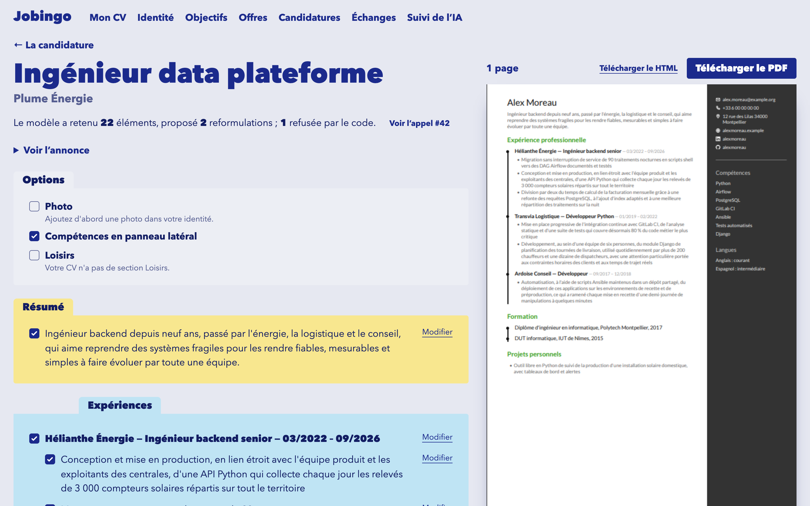
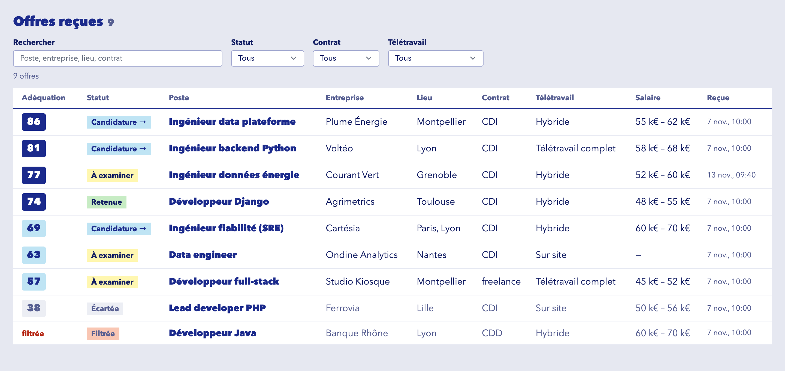
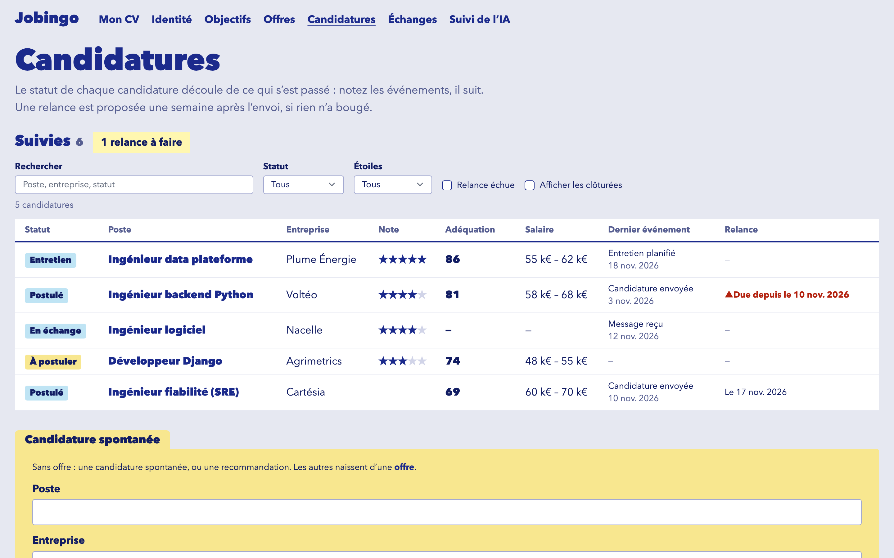
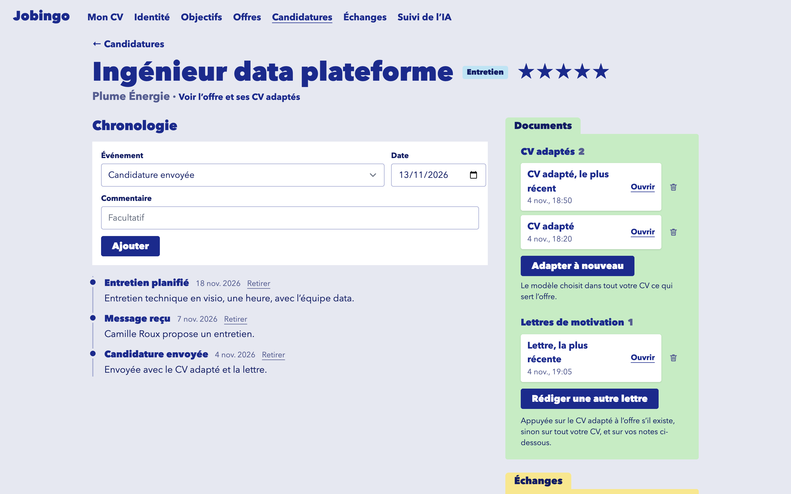
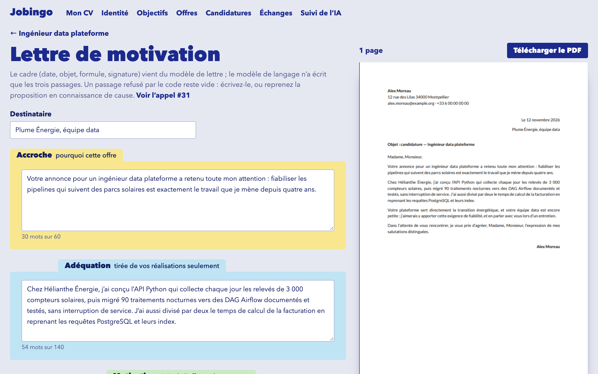
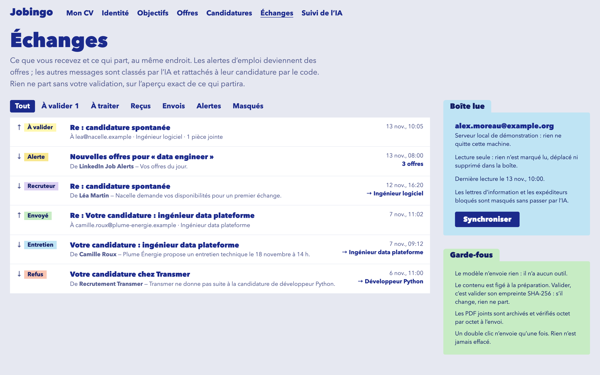
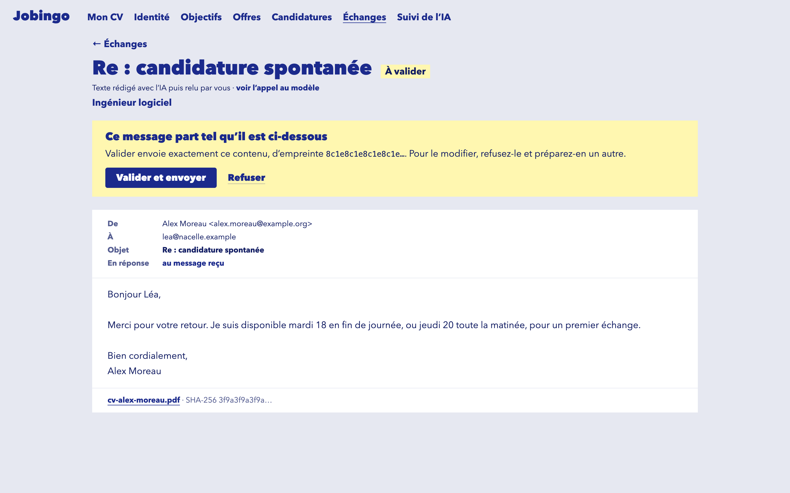
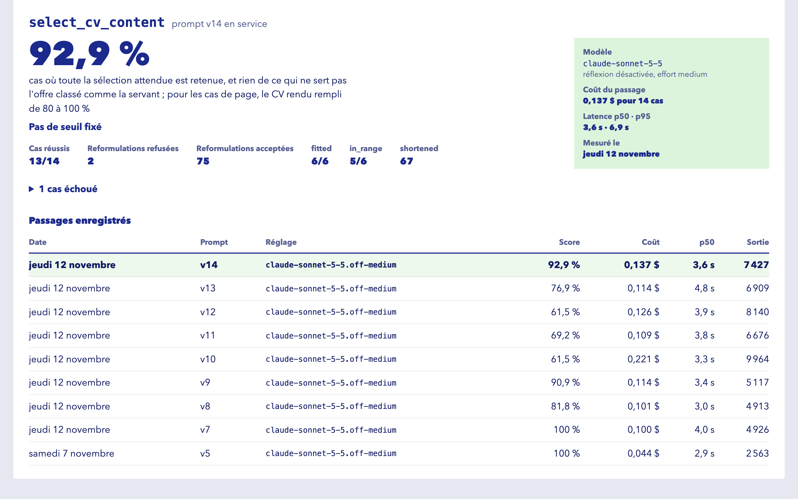

# Jobingo

An AI job search assistant that keeps the AI on a short leash. It collects and ranks job offers, tracks applications, tailors a CV and a cover letter to each offer, and drafts replies to recruiters. Nothing leaves without a human click.

**Status: work in progress.** Every part of the job search works end to end on one machine: the CV, offers and their scores, applications, adapted CVs and cover letters, mail read and sent through one approval queue, and the observability page. Each AI task has a measured eval. A fictional demo seed and a guided tour come next. The interface is in French.



## Where it comes from

Jobingo succeeds a private Python proof of concept: a local, single-user app that already delegated bounded tasks to Claude behind an approval queue, with its prompts measured by evals.

The POC proved that the idea works. Jobingo rebuilds it as a real client-server application, with a typed API, PostgreSQL and a designed interface. Code is ported file by file, and reviewed at each port. Prompts and eval suites come over, but scores do not: every score gets measured again here before it is published.

## What this project sets out to demonstrate

It is a public portfolio project. It aims to show how to deliver an AI product that works, is clean, and can be trusted, by making each of these claims checkable in the code.

**Personal data stays away from the model.** Name, contact details, links and photo are stored apart from the CV, and code puts them back at render and send time. An import contract, checked in CI, makes the code that calls the model unable to import identity, and known identity values are replaced before each call. The limit is real: a CV's content can still identify someone, and the model reads incoming mail, which may name the candidate in forms that redaction misses. So this reduces exposure, and it is not an absolute guarantee.

**AI as restricted as possible.** The model has no tools. It only runs bounded tasks, each with a typed input and a validated structured output. Filters, scores, rendering and sending are deterministic code, and everything outbound goes through one approval queue and one executor.

**One exhaustive CV, adapted per offer, never invented.** You keep your whole career in one document. The AI selects from it and lightly rewrites it, code checks the rewrites, and you validate the result on a diff screen. Code carrying model output cannot write the source CV: an architecture test enforces it.

**Measured, not claimed.** An observability page shows Claude usage and cost, eval results, logs and individual calls, linked to each other. Every figure on it comes from a real measurement, and a task with no result reads "not measured yet" ([design](docs/observability.md)). Model or prompt changes are adopted only if their eval result is at least as good.

**Interface quality is a requirement.** The screens follow one visual direction, "Classeur": a binder of index cards with one colour per CV section.

## What works today

The screenshots below show the fictional persona Alex Moreau. They are taken by `make screenshots`, which runs the real client against fictional data, with no database and no model. The CV, the letter and their PDFs are rendered by the server's own code, and the eval results are the measured ones.

### One CV, two equivalent ways to write it

Fill in the cards, or write plain text in a defined format. They are two views of one document, and a save from either one stores the same canonical form, as a new version. Saving checks for conflicts, so one tab cannot silently overwrite another. Diagnostics point at problems line by line, and flag personal data typed into the CV by mistake.

| Cards | Plain text |
| ---- | ---- |
|  |  |

The text mode is a plain textarea for now. The section colours it should carry will come with CodeMirror.

Identity and photo are entered on their own page and only reach a document at render time.

### Offers, filtered by code and scored by criterion

Paste an offer, an alert or a digest: one call extracts each position, and code stores it, completing a known offer rather than duplicating it. Job alerts read from the mailbox become offers the same way. Your objectives' hard filters run in code first, and an offer they eliminate costs no call. The model then rates four criteria from 0 to 10, and code computes two scores from your weights, fit and salary, which are never mixed. Every score can be explained and recomputed, and one made on older objectives or an older CV is marked stale. Keeping or dismissing an offer is your decision, which scoring never changes.



The table sorts by fit, then salary, then company and title. A click on a header sorts on that column, a second reverses it, a third goes back. Search ignores case and accents, filters show as removable tags, and the whole state lives in the address, so a view can be bookmarked.

### Applications, with a status nobody sets by hand

An application's status follows from its timeline of events, so it can always be explained, and a follow-up is proposed a week after sending if nothing has happened. You give each application your own star rating. The table puts your stars first, then fit and salary, and hides closed applications unless you ask for them.



Each application holds its adapted CVs and cover letters, its contact, your notes on the company, and the mail tied to it.



### A CV adapted to an offer, on one page

From an application, one model call ranks the elements of the whole CV against the offer, and may lightly rewrite a line. Code checks the answer before anyone sees it: an id the CV does not have is dropped, and a rewrite that is too long, adds a number or uses a forbidden turn of phrase is refused, with the original kept. A proper noun a rewrite adds is flagged for you to check. Code then takes the ranking as far as the page holds, so the CV fills 80 % to 100 % of one page, the side panel and the main column each with its own content.

The diff screen (at the top of this page) shows the whole CV with what the model kept, rewrote, had refused or left out and why, next to the real PDF, rendered on the server with WeasyPrint. You tick, untick, adopt a refused rewrite or write your own words. The proposal is stored unchanged as the trail, your choices apart, and the source CV is never written. The template embeds its font, so the page count does not depend on the machine, and a [local check](docs/ats-check.md) reads the PDF the way recruiting tools do.

### Cover letters with checked sources

A letter's frame (date, subject, closing, signature) belongs to the template. The model writes three passages, each allowed to draw its facts only from declared sources: your achievements, the offer, your notes on the company. A passage with a figure from nowhere, over its word limit or with a forbidden phrase comes back empty, with the proposal and the reason beside it: you write it, or adopt it knowingly.



### Mail in, mail out, one approval queue

The "Échanges" screen reads the mailbox, read-only, and lists what was sent. Newsletters and blocked senders are hidden by rules. Other messages are classified by the model, and code ties each one to its application by thread, contact address or company name. A refusal or an interview becomes an event on the application only when you click.



The model drafts replies, and you edit them. Whatever leaves, a reply or an application with its PDFs, is frozen when it is proposed: its content gets a SHA-256 and its PDFs are archived. You approve that exact preview with a click, and one executor sends it, in dry run by default. A gap the draft left, written `[À COMPLÉTER : …]`, blocks the send.



### Measured, on one page

The "Suivi de l'IA" section shows usage and cost per task and per day against the spending caps, every call with its prompts as the model read them, its answer and the events it caused, the eval results per prompt version and model, and the application log. Every figure comes from the call journal or a recorded eval run.



The eval results in service, on fictional cases:

| Task | Model | Measure | Result | Run cost | Measured |
| ---- | ---- | ---- | ---- | ---- | ---- |
| `extract_offer` v3 | Haiku 5.5 | fields extracted correctly | 108/108, 21/21 offer counts | 0.002 $ | 2026-11-10 |
| `score_offer` v1 | Haiku 5.5 | rank correlation of fit with a hand-made ranking (threshold 0.85) | 0.948 | 0.004 $ | 2026-11-07 |
| `select_cv_content` v14 | Sonnet 5.5 | cases keeping all that is expected and nothing that does not serve the offer, page filled 80 % to 100 % | 13/14 | 0.137 $ | 2026-11-12 |
| `draft_letter` v4 | Sonnet 5.5 | letters with no passage refused or left empty | 6/6 | 0.067 $ | 2026-11-07 |
| `classify_message` v2 | Haiku 5.5 | messages in the expected category (threshold 0.90) | 49/50, 11/11 interview dates | 0.004 $ | 2026-11-09 |
| `draft_reply` v4 | Sonnet 5.5 | drafts with no problem found by code | 6/6 | 0.021 $ | 2026-11-10 |

These sets are small, from 6 to 50 cases. They catch a regression, they do not prove general quality. The `injection` suite, which checks that instructions hidden in mail are not followed, is written but not measured yet. The Evals tab holds the current figures.

### Engineering foundations

- **A contract that cannot drift.** FastAPI's OpenAPI schema generates the client's TypeScript types, and a test and CI fail on any difference.
- **A local server that is still protected.** Having no login does not make it open, since any web page can try to call localhost, and this app can send mail. It binds `127.0.0.1`, rejects other `Host` values, accepts writes only as JSON from an allowed `Origin`, and sends in dry run unless told otherwise.
- **Real servers in tests.** pytest runs against a real Postgres, and mail against local Mailpit and GreenMail servers in Docker, in CI too. Tests never call a real model: a fake client answers.
- **Strict checks.** ruff, pyright strict, import-linter layer contracts, bandit. On the client, type checks, ESLint, Vitest and Playwright.
- **Explicit SQL and numbered migrations**, no ORM. Every business row carries a `user_id`, although the app runs with a single account and no login.
- **A public repository with no personal data.** Everything committed is fictional, including the persona Alex Moreau in these screenshots.

### Built with Claude Code, under guardrails

This repository is developed with Claude Code, and its setup is part of what it shows.

- [Deny rules and hooks](.claude/settings.json) keep the agent away from secrets and from the database holding real data, and a Stop hook prevents a turn from ending on a failing tree.
- What the user settles or corrects is recorded in [`docs/decisions/`](docs/decisions/INDEX.md) and [`docs/lessons/`](docs/lessons/INDEX.md), so that it holds in every later session.
- A frontend and a backend agent can [work as a pair](docs/parallel-work.md) on one feature, against a fictional database.

## Roadmap

Small vertical steps, each one reviewable and working end to end.

- [x] Foundation: API, Postgres, migrations, local protections, API contract, CI
- [x] CV editor, in both modes
- [x] CV rendering and PDF preview
- [x] LLM layer, prompts and evals, with the observability page, then per-offer CV tailoring on a diff screen
- [x] Offer intake and scoring
- [x] Application tracking and cover letters
- [x] Mail, drafted replies and the approval queue
- [ ] Demo: a full fictional seed and a guided tour

Hosting and SaaS features (billing, OAuth, a template gallery) are out of scope.

## Stack

- **Client:** SvelteKit SPA, Svelte 5 runes, TypeScript, Tailwind 4, Vitest, Playwright
- **Server:** FastAPI, Pydantic v2, Python 3.12+, uv workspace, WeasyPrint
- **Database:** PostgreSQL in Docker Compose, psycopg 3
- **AI:** Anthropic SDK behind an `LLMClient` interface, strict structured output, a fake client in tests
- **Mail:** IMAP read-only, SMTP through the one executor; Mailpit and GreenMail locally
- **Planned:** Procrastinate, SSE, CodeMirror 6

```text
apps/web/        SvelteKit client
apps/api/        FastAPI: JSON routes, security middleware, serves the built client
packages/core/   config, db, migrations; domain, services, llm, render, hitl, connectors
tests/           backend tests, against a real Postgres
evals/           eval harness, suites, fictional cases and committed results
docs/            guides, decisions and lessons
```

## Run it locally

You need Docker, [uv](https://docs.astral.sh/uv/), Node with `corepack enable`, and Pango for PDF rendering (`brew install pango` on macOS).

```sh
uv sync && pnpm install
make db-up        # Postgres on 127.0.0.1:5433
make mail-up      # local mail servers: Mailpit (sent mail at :8025) and GreenMail (IMAP)
make api          # API at http://127.0.0.1:8000
make web          # client at http://localhost:5173
```

`make check` runs every check, with the database and the mail servers up. `make e2e` runs the Playwright tests, and `make screenshots` retakes the screenshots above (it needs Google Chrome for its PDF viewer).
